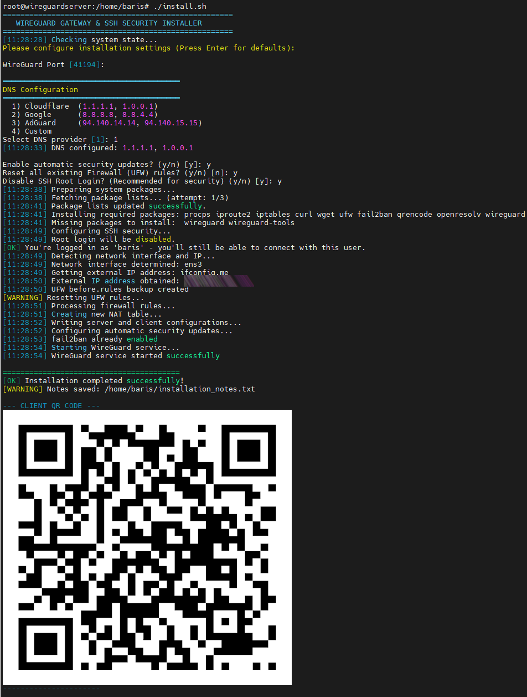

# 🛡️ WireGuard Secure Gateway

<div align="center">



**One-click WireGuard VPN server & SSH security hardening for Debian/Ubuntu.**

[English](README.md) | [Türkçe](README_TR.md)

[](LICENSE)
[](install.sh)
[](https://github.com/sinezty/wg-secure-gateway/actions/workflows/ci.yml)

</div>

---

## 📖 What is this?

A single bash script that turns a fresh VPS or server into a **fully secured WireGuard VPN server** in minutes. It handles everything: SSH hardening, firewall rules, WireGuard key generation, multi-client management, and QR code generation for mobile devices.

> **Looking for the client gateway?** If you want to route your entire home network through this VPN, check out 👉 [wg-client-gateway](https://github.com/sinezty/wg-client-gateway)

## ✨ Features

- 🔧 **One-Click Setup** — Automated for Debian 11/12/13, Ubuntu 20.04/22.04/24.04+, Raspbian, DietPi, Armbian
- 👥 **Multi-Client Management** — Easily add, list, view QR codes, or revoke clients at any time
- 🔒 **SSH Hardening** — Dynamic port detection, root login protection, auth attempts limiter, session timeouts (Ubuntu 24.04 socket-compatible)
- 🌐 **WireGuard VPN** — High-speed modern VPN with in-kernel routing and automated key generation
- 🧱 **Firewall (UFW)** — Native VPN routing (`ufw route allow`), default deny incoming, isolated NAT masquerade
- 🛡️ **Fail2ban with Journald** — SSH brute-force protection using `systemd` backend (fully compatible with modern Debian 12 & Ubuntu 24.04)
- 🔄 **Auto Updates** — Optional unattended-upgrades for security patches
- 🌍 **DNS Selection** — Choose from Cloudflare, Google, AdGuard, or custom DNS

## 🚀 Quick Start

> ⏱️ Installation takes approximately **2–3 minutes**.

```bash
curl -fsSL https://raw.githubusercontent.com/sinezty/wg-secure-gateway/main/install.sh | sudo bash
```

## 📦 Installation & Usage

```bash
# Option 1: Direct execution (recommended)
curl -fsSL https://raw.githubusercontent.com/sinezty/wg-secure-gateway/main/install.sh | sudo bash

# Option 2: Download first, then run
git clone https://github.com/sinezty/wg-secure-gateway.git
cd wg-secure-gateway
chmod +x install.sh
sudo ./install.sh
```

### 👥 Client Management Menu

After initial installation, running `sudo bash install.sh` automatically launches the **Management Panel**:

```text
====================================================
   WIREGUARD GATEWAY MANAGEMENT PANEL
====================================================
WireGuard is already installed and running on this server.

  1) Add a new client profile (QR Code)
  2) List existing clients
  3) Show QR Code / config for an existing client
  4) Revoke / delete a client
  5) Check WireGuard status & traffic (wg show)
  6) Reinstall / Reconfigure from scratch
  7) Exit
```

You can also use non-interactive CLI flags:
```bash
sudo bash install.sh --add-client myphone
sudo bash install.sh --revoke-client myphone
sudo bash install.sh --list
sudo bash install.sh --status
```

## ⚙️ Initial Configuration

The script walks you through an interactive setup:

| Setting | Default | Description |
|---------|---------|-------------|
| WireGuard Port | 41194 | UDP port for the VPN tunnel |
| DNS Provider | Cloudflare | DNS used by VPN clients (see table below) |
| Auto Updates | Yes | Automatic security patches via unattended-upgrades |
| Reset UFW | No | Option to wipe existing firewall rules |
| Disable Root Login | Yes | Blocks SSH root access (safely kept enabled if logged in as root) |

### DNS Providers

| # | Provider | Primary | Secondary |
|---|----------|---------|-----------|
| 1 | Cloudflare | `1.1.1.1` | `1.0.0.1` |
| 2 | Google | `8.8.8.8` | `8.8.4.4` |
| 3 | AdGuard | `94.140.14.14` | `94.140.15.15` |
| 4 | Custom | User-defined | User-defined |

## 📁 Generated Files

| File | What it is |
|------|------------|
| `/etc/wireguard/wg0.conf` | Server configuration |
| `/etc/wireguard/clients/*.conf` | Client profile configs |
| `~/<client-name>.conf` | Copy saved to your home directory |
| `/var/log/wg_setup.log` | Installation log |
| `~/installation_notes.txt` | Connection details summary |

## 🔐 Security Measures

| Layer | Protection |
|-------|-----------|
| SSH | Max 3 auth tries, session timeout, dynamic port detection |
| SSH | Root login disabled (safe lockout prevention if root) |
| SSH | fail2ban brute-force protection (`backend = systemd`) |
| Firewall | UFW: deny incoming, allow outgoing, isolated WireGuard routing |
| VPN | Curve25519, ChaCha20-Poly1305, BLAKE2s state-of-the-art crypto |
| System | Automatic security updates (`unattended-upgrades`) |

## 💻 Requirements

- **OS**: Ubuntu 20.04+, Debian 11+, Raspbian, DietPi, or Armbian
- **Access**: Root or sudo privileges
- **Network**: Active internet connection

## 🔗 Related Projects

| Project | Description |
|---------|-------------|
| 👉 **[wg-client-gateway](https://github.com/sinezty/wg-client-gateway)** | Turn a Raspberry Pi into a VPN gateway — route your entire home network through this VPN server |

## 🤝 Contributing

Pull requests are welcome! For major changes, please open an issue first to discuss what you would like to change.

## 📝 License

MIT

## 👤 Author

Barış Y.
