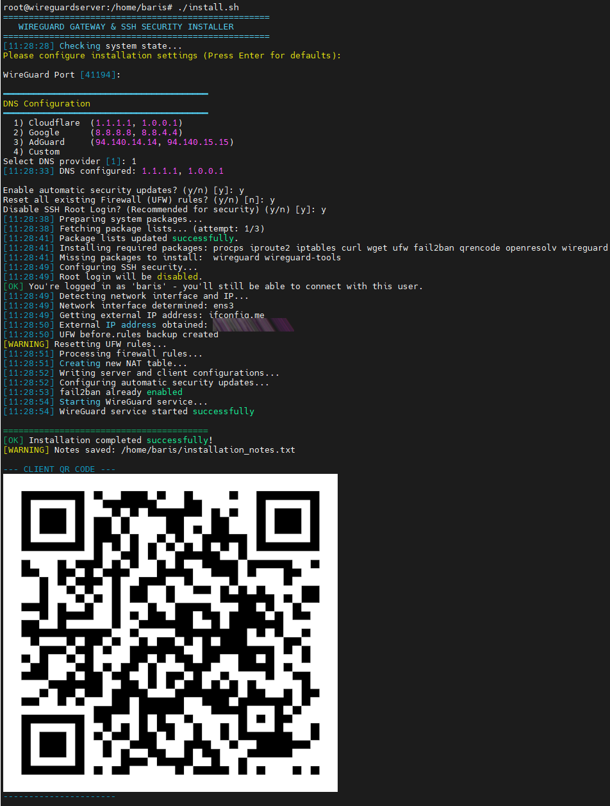

# 🛡️ WireGuard Secure Gateway

<div align="center">



**Ubuntu/Debian tabanlı sunucularda tek komutla WireGuard VPN ve SSH güvenlik kurulumu.**

[English](README.md) | [Türkçe](README_TR.md)

[](LICENSE)
[](install.sh)
[](https://github.com/sinezty/wg-secure-gateway/actions/workflows/ci.yml)

</div>

---

## 📖 Bu Nedir?

Tek bir bash script ile yeni bir VPS veya sunucuyu dakikalar içinde **tam güvenlikli bir WireGuard VPN sunucusuna** dönüştürür. SSH güçlendirme, güvenlik duvarı kuralları, WireGuard anahtar üretimi, çoklu istemci (client) yönetimi ve mobil cihazlar için QR kod oluşturma işlemlerinin hepsini otomatik yapar.

> **Client gateway mı arıyorsunuz?** Tüm ev ağ trafiğinizi bu VPN üzerinden yönlendirmek istiyorsanız 👉 [wg-client-gateway](https://github.com/sinezty/wg-client-gateway)

## ✨ Özellikler

- 🔧 **Tek Komutla Kurulum** — Debian 11/12/13, Ubuntu 20.04/22.04/24.04+, Raspbian, DietPi, Armbian tam otomatik
- 👥 **Çoklu İstemci (Client) Yönetimi** — İstediğiniz zaman yeni profil ekleyin, listeyin, QR kodunu görün veya silin
- 🔒 **SSH Güçlendirme** — Dinamik port algılama, root giriş kontrolü, deneme sınırı, oturum zaman aşımı (Ubuntu 24.04 socket uyumlu)
- 🌐 **WireGuard VPN** — Kernel seviyesinde yüksek hızlı VPN, otomatik anahtar üretimi
- 🧱 **Güvenlik Duvarı (UFW)** — UFW native routing (`ufw route allow`), gelen trafiği engelleme, izole NAT masquerade
- 🛡️ **Fail2ban (Journald Backend)** — SSH brute-force koruması (modern Debian 12 ve Ubuntu 24.04 ile %100 uyumlu)
- 🔄 **Otomatik Güncellemeler** — İsteğe bağlı güvenlik güncellemeleri (`unattended-upgrades`)
- 🌍 **DNS Seçimi** — Cloudflare, Google, AdGuard veya özel DNS

## 🚀 Hızlı Başlangıç

> ⏱️ Kurulum yaklaşık **2–3 dakika** sürer.

```bash
curl -fsSL https://raw.githubusercontent.com/sinezty/wg-secure-gateway/main/install.sh | sudo bash
```

## 📦 Kurulum ve Kullanım

```bash
# Yöntem 1: Doğrudan çalıştırma (önerilen)
curl -fsSL https://raw.githubusercontent.com/sinezty/wg-secure-gateway/main/install.sh | sudo bash

# Yöntem 2: İndirip çalıştırma
git clone https://github.com/sinezty/wg-secure-gateway.git
cd wg-secure-gateway
chmod +x install.sh
sudo ./install.sh
```

### 👥 İstemci (Client) Yönetim Paneli

İlk kurulum tamamlandıktan sonra `sudo bash install.sh` komutunu tekrar çalıştırdığınızda otomatik olarak **Yönetim Paneli** açılır:

```text
====================================================
   WIREGUARD GATEWAY MANAGEMENT PANEL
====================================================
WireGuard is already installed and running on this server.

  1) Add a new client profile (QR Code)
  2) List existing clients
  3) Show QR Code / config for an existing client
  4) Revoke / delete a client
  5) Check WireGuard status & traffic (wg show)
  6) Reinstall / Reconfigure from scratch
  7) Exit
```

Komut satırından doğrudan yönetim de yapabilirsiniz:
```bash
sudo bash install.sh --add-client telefon
sudo bash install.sh --revoke-client telefon
sudo bash install.sh --list
sudo bash install.sh --status
```

## ⚙️ İlk Kurulum Yapılandırması

Script interaktif olarak sizi yönlendirir:

| Ayar | Varsayılan | Açıklama |
|------|-----------|----------|
| WireGuard Port | 41194 | VPN tüneli için UDP portu |
| DNS Sağlayıcı | Cloudflare | VPN client'larının kullanacağı DNS (tablo aşağıda) |
| Otomatik Güncellemeler | Evet | unattended-upgrades ile güvenlik yamaları |
| UFW Sıfırlama | Hayır | Mevcut güvenlik duvarı kurallarını sıfırlama seçeneği |
| Root Girişi Kapatma | Evet | SSH root erişimini engeller (root iseniz güvenliğiniz için açık tutulur) |

### DNS Sağlayıcıları

| # | Sağlayıcı | Birincil | İkincil |
|---|-----------|---------|---------|
| 1 | Cloudflare | `1.1.1.1` | `1.0.0.1` |
| 2 | Google | `8.8.8.8` | `8.8.4.4` |
| 3 | AdGuard | `94.140.14.14` | `94.140.15.15` |
| 4 | Özel | Kullanıcı tanımlı | Kullanıcı tanımlı |

## 📁 Oluşturulan Dosyalar

| Dosya | Ne işe yarar |
|-------|-------------|
| `/etc/wireguard/wg0.conf` | Sunucu yapılandırması |
| `/etc/wireguard/clients/*.conf` | İstemci konfigürasyon profilleri |
| `~/<client-name>.conf` | Ev dizininize kopyalanan client dosyası |
| `/var/log/wg_setup.log` | Tam kurulum logu |
| `~/installation_notes.txt` | Bağlantı detayları ile özet |

## 🔐 Güvenlik Önlemleri

| Katman | Koruma |
|--------|--------|
| SSH | Maks 3 deneme, oturum zaman aşımı, dinamik port tespiti |
| SSH | Root girişi kapatılır (root iseniz kilitlenmeyi önler) |
| SSH | fail2ban brute-force koruması (`backend = systemd`) |
| Güvenlik Duvarı | UFW: tüm gelen engellenir, giden serbest, izole WireGuard routing |
| VPN | Curve25519, ChaCha20-Poly1305, BLAKE2s modern şifreleme |
| Sistem | Otomatik güvenlik güncellemeleri (`unattended-upgrades`) |

## 💻 Gereksinimler

- **İşletim Sistemi**: Ubuntu 20.04+, Debian 11+, Raspbian, DietPi veya Armbian
- **Erişim**: Root veya sudo yetkisi
- **Ağ**: Aktif internet bağlantısı

## 🔗 İlgili Projeler

| Proje | Açıklama |
|-------|----------|
| 👉 **[wg-client-gateway](https://github.com/sinezty/wg-client-gateway)** | Raspberry Pi'yi VPN ağ geçidine dönüştürün — tüm ev ağ trafiğinizi bu VPN sunucusu üzerinden yönlendirin |

## 🤝 Katkıda Bulunma

Pull request'ler memnuniyetle karşılanır. Büyük değişiklikler için lütfen önce issue açarak tartışalım.

## 📝 Lisans

MIT

## 👤 Yazar

Barış Y.
